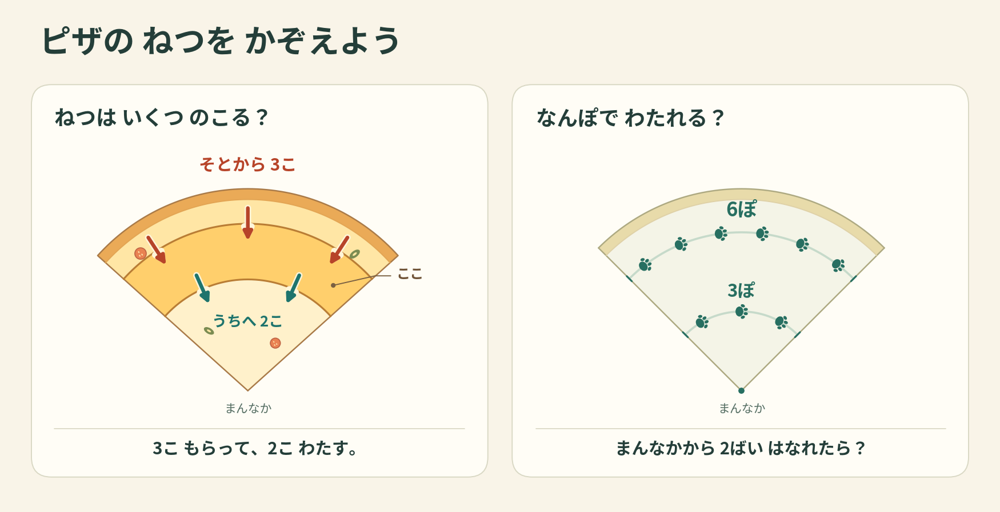

🍕 黄色いところに指をおいてね。そこから外へ１歩いくと、１度あつい。内へ１歩いくと、１度つめたい。さて、指をおいたところは、このあと温まるかな？

**左の絵の、やじるしを数えてみよう。** 外から３こもらって、内へ２こわたす。**１このこる。だから、ちょっと温まる！** どちらも１歩で１度ちがうのに、どうしてだろう？　黄色いところのふちを、指でなぞってみて。外のふちのほうが長いね。そのぶん、熱の通れるところが多いんだ。

**右の絵は、わんこの足あと。** ピザの左はしから右はしまで、内の道は３歩。まんなかから２倍はなれた道は６歩。もし左はしと右はしで６度ちがって、歩くたびに同じだけ温度が上がるなら、内の道は１歩で２度、外の道は１歩で１度だね。だから横のふちを通る熱は半分。しかも、同じ厚みに切ったひとかけらは、外では広さが２倍になる。**ひと口ぶんに分けると、半分の半分で４分の１。**

ここまでで、式にいる材料がそろったよ。**もらう熱から、わたす熱を引いて、ひとかけらの広さで割る。** ひとかけらをどんどん小さくすると、その場所がおとなりとの熱のやりとりでどれくらい温まるかを表す数が出てくる。これがラプラシアン。

### いま数えたものを式にする

温度を $T$、まんなかからの距離を $r$、向きを $\theta$（ラジアン）とします。

**内と外。** 外向きの温度の傾き $T_r$ に、ふちの長さ $r\,d\theta$ を掛けると、そこを内向きに通る熱の量に比例します。外のふちで受け取る分から、内のふちで渡す分を引き、面積 $r\,dr\,d\theta$ で割ると、

$$
\frac{\partial_r(rT_r)\,dr\,d\theta}{r\,dr\,d\theta}
=\frac1r\frac{\partial}{\partial r}(rT_r)
=T_{rr}+\frac1rT_r .
$$

**右と左。** 足あとに沿った道のりを $s$ とすると、$ds=r\,d\theta$。道のりあたりの温度の傾きは $\partial_s T=(1/r)\partial_\theta T$ です。左右でその傾きがどれだけ変わるか、もう一度、道のりで微分します。同じ円の上では $r$ は一定なので、

$$
\frac{\partial^2 T}{\partial s^2}
=\frac1{r^2}\frac{\partial^2 T}{\partial\theta^2}.
$$

両方を足すと、**平面の極座標ラプラシアン**のできあがり。

$$
\boxed{\displaystyle
\Delta T=
\frac{\partial^2 T}{\partial r^2}
+\frac1r\frac{\partial T}{\partial r}
+\frac1{r^2}\frac{\partial^2 T}{\partial\theta^2}}
\qquad (r>0)
$$

最初のピザみたいに、どの向きでも外へ１歩ごとに１度あつくなる $T=r$ を入れると、答えは $0+\frac1r+0>0$。**やじるしが１こ残ったのは、まんなかの項 $\frac1r T_r$ だよ。** 🐾
